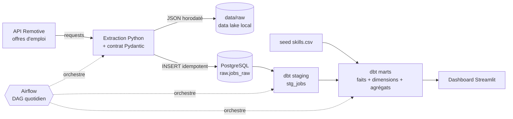

# Job Market Intelligence Platform

Pipeline ELT automatisé qui collecte chaque jour les offres d'emploi data (Data Engineer, Data Analyst, Data Scientist...), les valide, les transforme en modèle dimensionnel et répond à une question concrète : **quelles compétences et quels salaires le marché demande-t-il ?**

> Stack : Python · Pydantic · Apache Airflow · dbt · PostgreSQL · Streamlit · Docker · GitHub Actions

## Architecture



**Flux du DAG `job_market_pipeline`** : `extract_and_load` → `dbt_seed` → `dbt_run` → `dbt_test`

## Source des données

Les offres d'emploi proviennent de l'[API publique Remotive](https://github.com/remotive-com/remote-jobs-api). Remotive est la source des données : chaque offre affichée dans le dashboard renvoie vers son annonce d'origine sur [remotive.com](https://remotive.com).

- **Fréquence** : 1 appel par jour et par catégorie, dans la limite conseillée par Remotive (4 appels par jour au maximum).
- **Délai** : Remotive publie ses offres avec 24 heures de retard.
- **Données d'exemple** : `data/sample_jobs.json` contient des offres **fictives**, écrites pour la démo hors-ligne et les tests. Elles ne proviennent pas de Remotive.
- **Usage** : ce projet est un projet d'apprentissage. Les offres collectées ne sont ni republiées ni redistribuées.

## Modèle de données

| Couche | Objet | Rôle |
|---|---|---|
| raw | `raw.jobs_raw` | Payload JSON d'origine, 1 ligne par offre et par jour (historique) |
| staging | `stg_jobs` | Dédoublonnage, JSON déplié, HTML retiré, salaire analysé, métier et séniorité déduits |
| marts | `dim_company` | Dimension entreprise |
| marts | `fct_job_postings` | Fait : une ligne par offre |
| marts | `fct_job_skills` | Fait : une ligne par couple (offre, compétence) |
| marts | `mart_skill_demand`, `mart_salary_summary`, `mart_postings_trend` | Agrégats prêts pour la BI |

## Qualité des données (3 niveaux)

1. **À l'entrée** : chaque offre passe par un modèle Pydantic ; les offres invalides sont comptées et écartées (voir l'offre `1011` volontairement invalide dans `data/sample_jobs.json`).
2. **À l'écriture** : clé primaire `(source, job_id, extracted_date)` + `ON CONFLICT DO NOTHING` : relancer le pipeline ne crée aucun doublon.
3. **Après transformation** : tests dbt (unicité, non-nullité, valeurs acceptées, intégrité référentielle, test singulier sur les fourchettes salariales) + contrôle de fraîcheur de la source.

## Démarrage rapide

Prérequis : Docker et Docker Compose.

```bash
cp .env.example .env        
docker compose up -d --build
```

| Service | URL | Identifiants |
|---|---|---|
| Airflow | http://localhost:8080 | `admin` / `admin` |
| Dashboard | http://localhost:8501 | - |
| PostgreSQL | `localhost:5433` | `jobs` / `jobs` (base `warehouse`) |

1. Ouvrez Airflow et déclenchez le DAG **`job_market_pipeline`** (bouton ▶).
2. Quand les 4 tâches sont vertes, ouvrez le dashboard.

**Démo hors-ligne** (sans appel à l'API) : mettez `USE_SAMPLE_DATA=true` dans `.env` puis relancez `docker compose up -d`.

## Développement local (sans Docker pour Python)

```bash
python -m venv .venv && source .venv/bin/activate
pip install -r requirements.txt

docker compose up -d postgres            # base seule
export WAREHOUSE_HOST=localhost DBT_PROFILES_DIR=dbt

python -m jobmarket.pipeline --sample    # ingestion sur les données d'exemple
dbt build --project-dir dbt              # seed + modèles + tests
pytest                                   # tests unitaires + intégration
```

## Structure

```
├── dags/                  DAG Airflow
├── src/jobmarket/         extraction, validation, chargement
├── dbt/                   staging, marts, seed, tests
├── dashboard/             application Streamlit
├── docker/                Dockerfile Airflow (dbt en venv séparé) + init Postgres
├── data/                  données d'exemple + zone raw locale
├── tests/                 pytest
└── .github/workflows/     CI : lint, tests, ingestion, dbt build
```

## Choix techniques

- **ELT plutôt qu'ETL** : les données brutes sont conservées telles quelles, les transformations vivent en SQL versionné (dbt).
- **dbt dans un venv séparé** dans l'image Airflow, pour éviter les conflits de dépendances.
- **Ingestion idempotente** : le pipeline peut être relancé ou rejoué sans risque.
- **Détection des compétences pilotée par une seed** (`skills.csv`) : ajouter une technologie = ajouter une ligne, sans toucher au SQL.
- **Salaires jamais mélangés entre devises**.

## Limites connues

- Les salaires sont extraits d'un texte libre : les fourchettes ambiguës (ex. « 50-60k ») peuvent être approximatives.
- La détection de compétences par mots-clés ne comprend pas le contexte (voir la piste IA ci-dessous).


